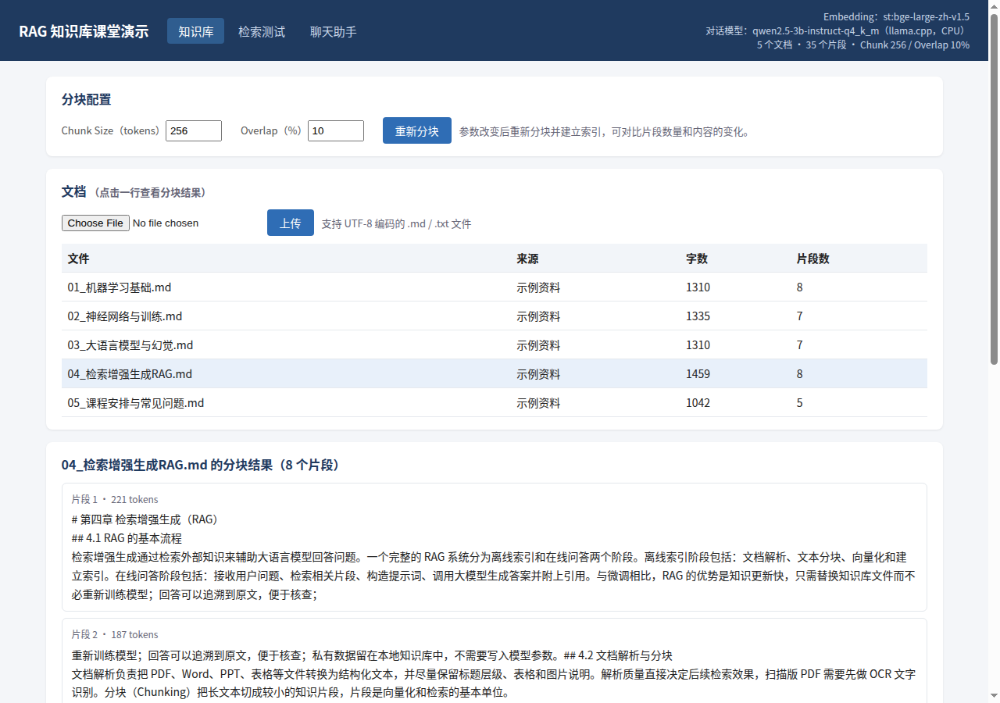
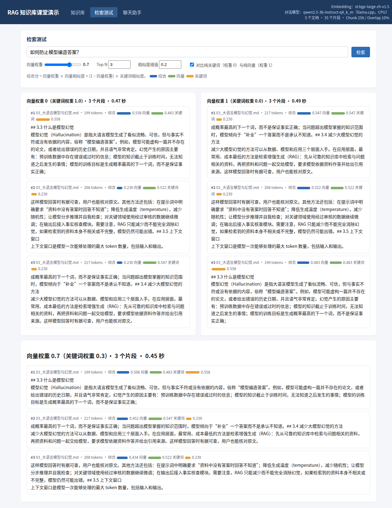
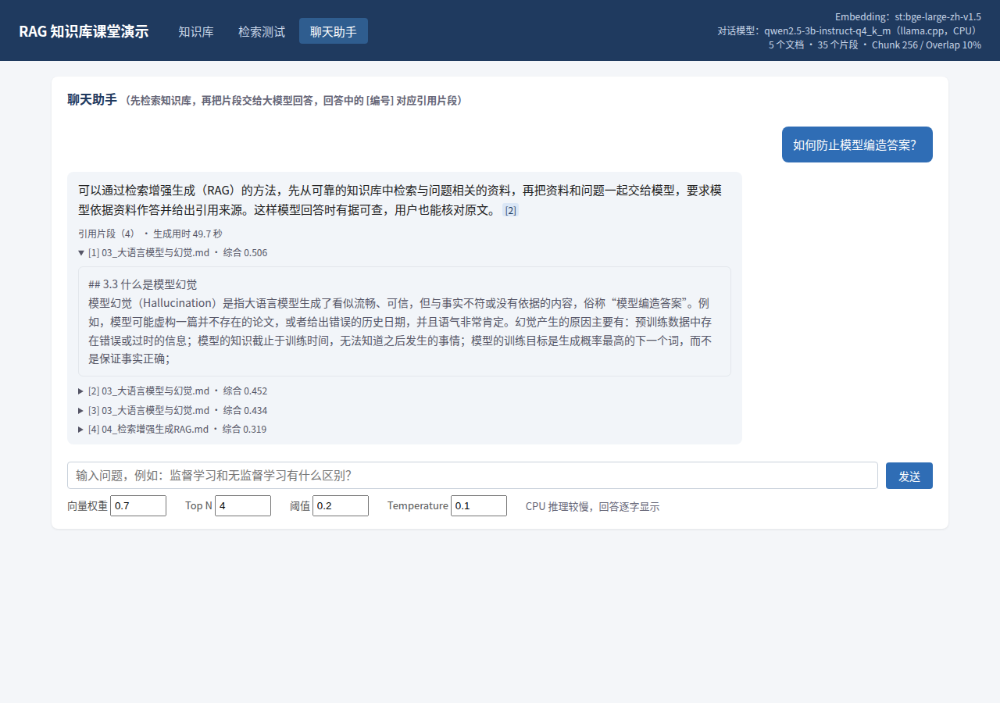
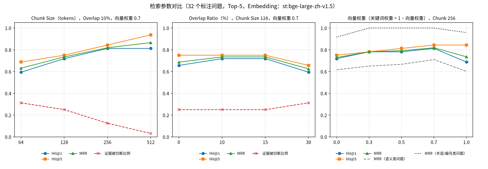

# rag-ragflow-kit：Ollama + RAGFlow 知识库搭建配套代码

基于 Ollama + RAGFlow 的 RAG 知识库搭建、检索评测与网页演示代码。

> 详细教程 `docs/RAG_完整教程.md`（及 PDF / Word 版）未随本仓库发布。修改 Markdown 后可用 `python docs/build_docs.py` 重新生成，需要 pandoc 和 Chrome。

## 功能截图

网页演示（`web_demo/app.py`）不需要 Docker 和 RAGFlow，直接在浏览器里完成建库、检索和问答。

### 知识库：上传文档与分块



支持上传 UTF-8 编码的 `.md` / `.txt`，调整 Chunk Size 与 Overlap 后重新分块，逐篇查看切分出的片段。

### 检索测试：对比不同检索权重



同一问题可分别用纯关键词、纯向量、混合权重检索，直观看出命中片段和分数构成（向量相似度、关键词得分）的差异。

### 聊天助手：带原文引用的回答



先从知识库检索，再把片段交给大模型作答；回答中的 `[1]` `[2]` 对应下方引用片段，可展开核对原文。支持调整向量权重、Top N、阈值和 Temperature。

### 参数实验：检索效果对比



用 32 个标注问题对比 Chunk Size、Overlap、向量权重对 Hit@1 / Hit@5 / MRR 以及证据被切断比例的影响。

## 目录

```text
scripts/windows/01_set_ollama_env.ps1       设置 OLLAMA_HOST / OLLAMA_MODELS，可选重启 Ollama
scripts/windows/02_pull_and_test_models.ps1 下载 bge-large-zh-v1.5 与对话模型，测试向量维度（1024）和对话
scripts/windows/03_deploy_ragflow.ps1       克隆 RAGFlow、切换 v1.0.0、docker compose 启动并等待就绪
scripts/windows/04_check_ragflow.ps1        检查容器状态，从容器内测试能否访问宿主机 Ollama
scripts/linux_macos/setup.sh                Linux / macOS 版：models | deploy | check
ragflow_client/setup_kb.py                  一键建库：建库 → 分块配置 → 上传 → 元数据 → 解析
ragflow_client/retrieval_eval.py            用 32 个标注问题评测检索（Hit@K、MRR）
ragflow_client/chat_demo.py                 创建聊天助手并通过 OpenAI 兼容接口提问
local_lab/run_experiments.py                本地对比 Chunk Size / Overlap / Embedding 权重
local_lab/show.py                           查看分块结果、单个问题的检索得分
web_demo/app.py                             CPU 版网页演示（知识库 / 检索测试 / 聊天助手），不需要 Docker
sample_docs/                                5 份示例课程资料
eval/questions.jsonl                        测试问题（含原文依据）
tests/                                      自动化测试（含模拟 RAGFlow 1.0 / 0.2x 的假服务）
```

## 快速开始（Windows PowerShell）

```powershell
cd scripts\windows
powershell -ExecutionPolicy Bypass -File .\01_set_ollama_env.ps1 -ModelsDir "D:\ollama\models" -Restart
powershell -ExecutionPolicy Bypass -File .\02_pull_and_test_models.ps1
powershell -ExecutionPolicy Bypass -File .\03_deploy_ragflow.ps1 -InstallDir "D:\ragflow"
powershell -ExecutionPolicy Bypass -File .\04_check_ragflow.ps1
cd ..\..
```

然后在 RAGFlow 界面添加 Ollama 模型（教程第 3.4 节）并创建 API Key，再运行：

```powershell
python -m pip install -r requirements.txt
copy config\.env.example config\.env      # 填入 RAGFLOW_API_KEY
python -m ragflow_client.setup_kb
python -m ragflow_client.retrieval_eval --keyword-weights 0.7,0.3,0
python -m ragflow_client.chat_demo "如何防止模型编造答案？"
```

不启动 RAGFlow 也能做参数实验（需要 Ollama 中已有 bge-large-zh-v1.5）：

```powershell
python -m local_lab.run_experiments
python -m local_lab.show search "如何防止模型编造答案？" --vector-weight 0
```

## 网页演示（不需要 Docker 和 RAGFlow）

```powershell
python -m pip install -r requirements.txt
$env:OLLAMA_CHAT_MODEL = "qwen2.5:3b"     # 用 Ollama 中的模型；不用 Ollama 的方式见教程第 10 章
python -m web_demo.app                    # 浏览器打开 http://localhost:8000
```

默认只监听本机。加 `--host 0.0.0.0` 可让局域网访问，但演示没有登录和权限控制，只应在课堂局域网中临时开放。

## 测试

```powershell
python -m pytest -q tests
```

测试不需要 RAGFlow 和模型：API 部分在本机启动一个假服务，分别按 1.0 和 0.2x 的接口规则校验请求。
